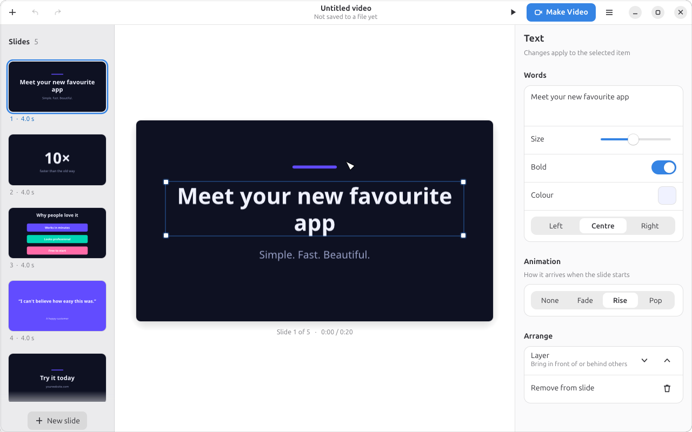
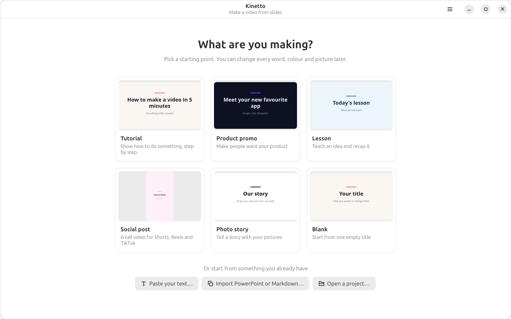

# Kinetto

**Slides in, video out.** Kinetto makes a polished video from slides, with no
editing skills needed: pick a starting point, type your story, choose a look,
press **Make Video**.



## What it does

- **Start fast** — templates (Tutorial, Product promo, Lesson, Social post,
  Photo story), or paste text, or import a PowerPoint or Markdown file.
- **Looks, not settings** — eight colour-and-motion looks restyle the whole
  video in one click; items animate in by themselves.
- **Text, shapes and pictures** — drag, resize, undo everything; pictures are
  cropped to fit, never stretched.
- **Sound** — three moods of generated, royalty-free music or your own song;
  record a voice for any slide. Music ducks under speech and the result is
  levelled to a standard loudness.
- **Out** — MP4 (H.264 + Opus, made on your GPU at about 2× real time), an
  animated GIF, a PDF of the slides, or present full screen (F5).
- **Never lose work** — saves itself, and a crash copy is offered back.

Wide, tall (Shorts/Reels) and square videos are supported; changing shape
moves items to fit.



## Build

Rust 1.95 or newer. On Linux you also need the ALSA headers
(`sudo apt install libasound2-dev`).

```sh
cargo run --release -p kinetto          # the editor
cargo run --release -p kinetto-cli -- export my.kinetto out.mp4
```

On Linux, `assets/install.sh` installs the binaries, icon and app-menu entry
for your user after a release build.

## How it's built

Pure Rust, in layers that only depend downwards (`cargo xtask layers` checks):

| Crate | Job |
|---|---|
| `kn-time`, `kn-geom`, `kn-model` | Integer time base, geometry, the project format |
| `kn-text`, `kn-media` | Text layout (parley), pictures and sounds |
| `kn-layout`, `kn-audio`, `kn-import` | Looks and layouts; music, mixing and loudness; importers |
| `kn-render`, `kn-export` | One `render_frame` for preview and export (vello); MP4/GIF/PDF |
| `kn-engine` | Commands with stable ids, undo, saving |
| `kn-ui`, `apps/*` | The GNOME-style editor (egui + wgpu) and the command line |

Every change is a command with a stable id (`slide.add`, `element.update`,
…), so the editor, undo and the command line drive the same thing.

## Licence

MIT or Apache-2.0, at your option.
